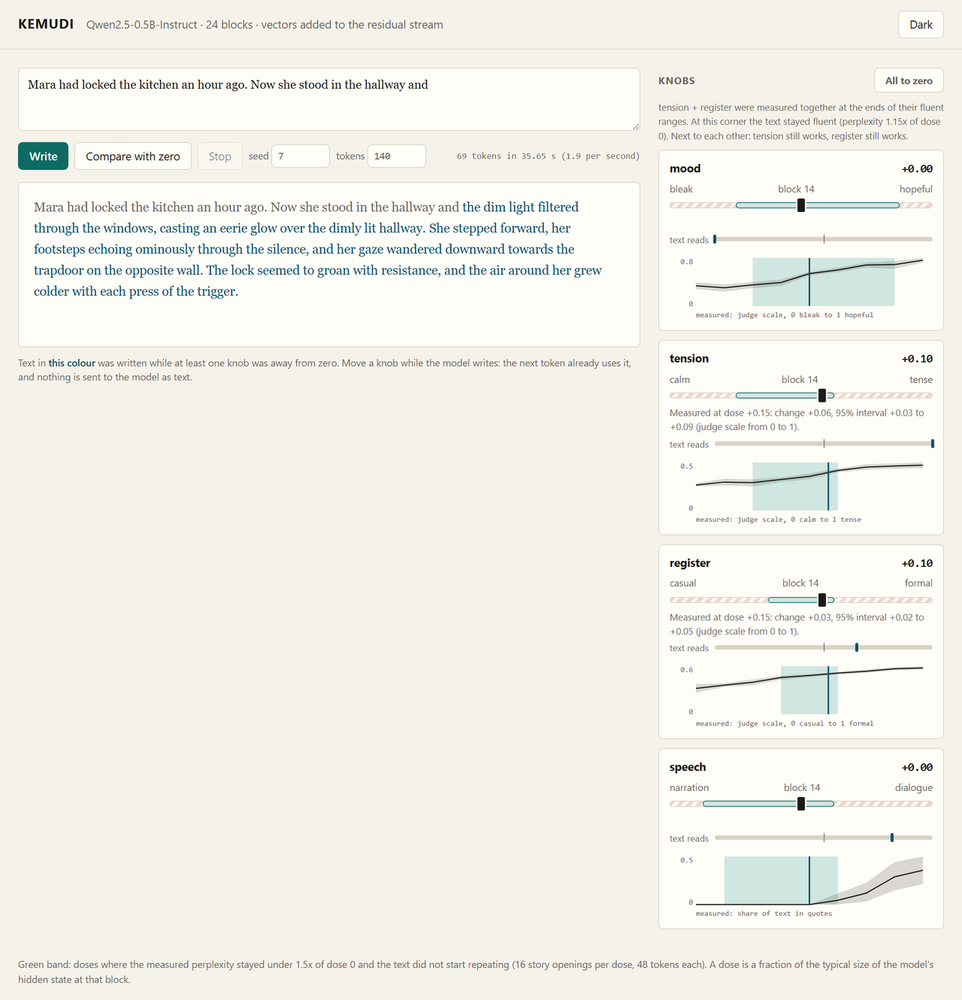
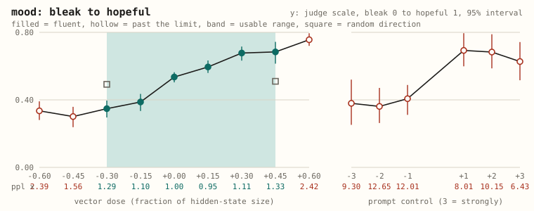
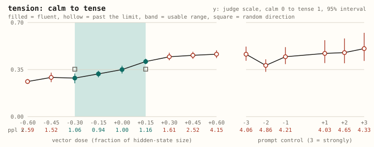
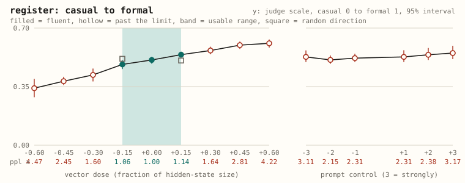
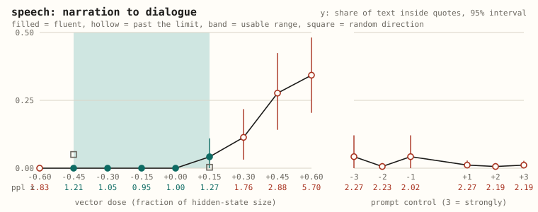

# Kemudi

Steering knobs for a local language model. Each knob adds a direction to the model's internal
state while it writes, with no instruction in the prompt, and each one ships with a measurement
of what it does to the text and the dose at which the text breaks.

*Kemudi* is Indonesian for a steering wheel or a rudder.



## What you get

- **Four knobs** for a story the model is writing: `mood` (bleak to hopeful), `tension` (calm to
  tense), `register` (casual to formal) and `speech` (narration to dialogue).
- **They act while the model writes.** Move a slider and the next words change. Nothing is added
  to the prompt and nothing is regenerated.
- **A green band on every slider**: the doses that were measured to keep the text fluent. Past
  the band the app warns you before you get there.
- **A gauge per knob** that reads the model's own state along that direction, word by word.
- **"Compare with zero"**: the same opening and the same random seed, written with and without
  your knobs, side by side.
- **It runs on your computer.** The model is Qwen2.5-0.5B-Instruct (about 1 GB, Apache-2.0), on
  the CPU. No account, no API key, no data leaves the machine.

## Start it

On Windows, double-click `Start Kemudi.cmd`. On macOS or Linux, run `./start-kemudi.sh`. The
first start installs Python packages and downloads the model once (about 1.3 GB together), then
opens the app in your browser. The Windows script was run from a fresh clone on
Windows 10 with the model already on disk. The shell script is run by CI on Linux and on macOS
at every push: a fresh machine installs, downloads the model, the app answers and a steered
sentence is written.

By hand, on any system with Python 3.10 or newer:

```
pip install torch --index-url https://download.pytorch.org/whl/cpu
pip install -e .
kemudi serve --open
```

In the terminal, without the app:

```
kemudi say "The lighthouse keeper climbed the stairs" --knob mood=0.3 --knob speech=0.3
```

The model is stored in `~/.cache/kemudi`. Set `KEMUDI_HOME` to keep it somewhere else.

## What was measured

Sixteen story openings that took no part in building the vectors were each continued for 48
tokens at nine doses per knob, always with the same random seed, so the only difference between
two doses is the vector. The unsteered model then scored every text. A dose is a fraction of the
typical size of the model's internal state at the block where the vector is added: dose 0.3
adds a vector 30% as long as that state.

<!-- results:start -->
| Axis | Block | Held-out AUC | Judge AUC | Usable doses | Effect at dose 0 | Vector, usable range | Random direction, same doses | Prompt, fluent levels | Rank corr. |
|---|---|---|---|---|---|---|---|---|---|
| mood (bleak to hopeful) | 14 | 0.95 | 0.914 | -0.30 to +0.45 | 0.54 | 0.35 to 0.68 | 0.49 to 0.51 | none | 0.816 |
| tension (calm to tense) | 14 | 0.97 | 0.945 | -0.30 to +0.15 | 0.35 | 0.29 to 0.41 | 0.35 to 0.35 | none | 0.645 |
| register (casual to formal) | 14 | 1.00 | 1.000 | -0.15 to +0.15 | 0.51 | 0.48 to 0.54 | 0.52 to 0.51 | none | 0.475 |
| speech (narration to dialogue) | 14 | 1.00 | counted | -0.45 to +0.15 | 0.00 | 0.00 to 0.04 | 0.05 to 0.00 | none | 0.279 |
<!-- results:end -->

How to read it:

- **Block**: which of the model's 24 blocks the vector is added after.
- **Held-out AUC**: how well the direction separates hand-written sentences of the two poles
  that had no part in building or choosing it. 1.0 is perfect, 0.5 is chance.
- **Judge AUC**: how well the instrument that scores the effect separates those same sentences.
  This is a check the judge had to pass, not an independent validation: the judge was chosen
  on these sentences (see "What changed on the way"). An AUC depends only on the order of the
  scores, so setting the judge's zero point on half of the sentences does not raise it. The
  held-out figure for the judge is in "How it works", step 5. Speech needs no judge: quotation
  marks are counted.
- **Usable doses**: the widest range around zero where the text passes two limits fixed in
  advance: perplexity at most 1.5 times that of dose 0, and at least 85% of the distinct word
  pairs of dose 0 (a repetition check). Perplexity says how surprising the unsteered model
  finds a text; fluent text scores low and broken text scores high.
- **Effect**: for mood, tension and register a 0 to 1 scale on which 0.27 is a typical
  hand-written sentence of the low pole and 0.73 one of the high pole. For speech it is the share
  of characters inside quotation marks.
- **Vector, usable range**: the effect at the two ends of the usable range.
- **Random direction, same doses**: a random vector of the same length, at right angles to the
  real one, added at the same block. It shows what a push of that size does when it points
  nowhere in particular.
- **Prompt, fluent levels**: the style requested in the system prompt and no vector, counted
  only at levels that pass the same two limits. `none` means no level passed.
- **Rank corr.**: Spearman correlation between dose and effect over every text inside the
  usable range.

### What the numbers say

- **mood** (bleak to hopeful): inside the usable range the vector moves the effect from 0.35 at dose -0.30 through 0.54 at zero to 0.68 at dose +0.45. A random direction at the same two doses gives 0.49 and 0.51. The prompt control reaches 0.36 and 0.69 at its best levels, with a perplexity ratio between 6.4 and 12.6, so no level passes the fluency limit. Over the whole grid, fluent or not, the vector takes the effect from 0.34 at dose -0.60 to 0.76 at dose +0.60.
- **tension** (calm to tense): inside the usable range the vector moves the effect from 0.29 at dose -0.30 through 0.35 at zero to 0.41 at dose +0.15. A random direction at the same two doses gives 0.35 and 0.35. The prompt control reaches 0.38 and 0.51 at its best levels, with a perplexity ratio between 4.0 and 4.9, so no level passes the fluency limit. Over the whole grid, fluent or not, the vector takes the effect from 0.26 at dose -0.60 to 0.46 at dose +0.60.
- **register** (casual to formal): inside the usable range the vector moves the effect from 0.48 at dose -0.15 through 0.51 at zero to 0.54 at dose +0.15. A random direction at the same two doses gives 0.52 and 0.51. The prompt control reaches 0.51 and 0.55 at its best levels, with a perplexity ratio between 2.1 and 3.2, so no level passes the fluency limit. Over the whole grid, fluent or not, the vector takes the effect from 0.34 at dose -0.60 to 0.61 at dose +0.60.
- **speech** (narration to dialogue): inside the usable range the vector moves the effect from 0.00 at dose -0.45 through 0.00 at zero to 0.04 at dose +0.15. A random direction at the same two doses gives 0.05 and 0.00. The prompt control reaches 0.01 and 0.01 at its best levels, with a perplexity ratio between 2.0 and 2.3, so no level passes the fluency limit. Over the whole grid, fluent or not, the vector takes the effect from 0.00 at dose -0.60 to 0.34 at dose +0.60.

Three things follow, and one of them is not flattering:

1. **Mood is the strong knob; tension and register work in a narrower range.** For all three
   the effect rises with the dose inside the usable range, and a random direction of the same
   size leaves it near the dose-0 value. Mood covers the most ground, tension less, and register
   least: its curve keeps rising over the whole grid, but the text stops being fluent beyond
   a dose of 0.15 either way, so only a small part of that curve is usable. None of the three
   covers the full distance between a typical low sentence (0.27) and a typical high one (0.73)
   while staying fluent.
2. **Speech is the weak knob.** Unsteered, this model wrote no dialogue at all for these
   openings. The vector does produce dialogue (see the chart), yet most of that happens past
   the perplexity limit, so the usable range ends early and the effect inside it is small. The
   limit treats any text the unsteered model finds unlikely as broken, and dialogue is
   unlikely to a model that would not have written it. The limit was fixed before measuring
   and was not changed afterwards. Read every dose in [docs/samples.md](docs/samples.md) and
   judge for yourself.
3. **The prompt control fails on this model, for a plain reason.** Many of its texts are the
   control instruction handed back and not a story:

<!-- echoes:start -->
| Axis | Vector, all doses | Random direction | Prompt control, all levels |
|---|---|---|---|
| mood | 0 of 144 | 0 of 32 | 33 of 96 |
| tension | 0 of 144 | 0 of 32 | 24 of 96 |
| register | 0 of 144 | 0 of 32 | 12 of 96 |
| speech | 0 of 144 | 0 of 32 | 6 of 96 |
<!-- echoes:end -->

   These texts are included in the prompt control's effect and perplexity numbers above.
   A text counts here when it contains `CONTROLS` or the axis name followed by a colon. This
   count was added after reading the texts, to explain the perplexity numbers; it is a
   description and was not planned. It says that a 0.5B model cannot follow a control block in
   its prompt. It does not say that vectors beat prompts in general: a large model follows such
   prompts well, and no large model was measured here.






In each chart the left panel is the vector and the right panel is the prompt control, on one
shared scale. Filled points pass the fluency limits, hollow points do not, the band is the
usable range, the squares are the random direction and the row of numbers under the axis is the
perplexity ratio.

The same curves as numbers: the mean effect at every dose with its 95% bootstrap interval over
the 16 texts. A star marks a dose that fails a fluency limit.

<!-- doses:start -->
| Dose | mood | tension | register | speech |
|---|---|---|---|---|
| -0.60 | 0.34 (0.28 to 0.39) * | 0.26 (0.24 to 0.28) * | 0.34 (0.29 to 0.40) * | 0.00 (0.00 to 0.00) * |
| -0.45 | 0.30 (0.24 to 0.36) * | 0.29 (0.26 to 0.33) * | 0.38 (0.36 to 0.41) * | 0.00 (0.00 to 0.00) |
| -0.30 | 0.35 (0.30 to 0.40) | 0.29 (0.25 to 0.32) | 0.42 (0.38 to 0.46) * | 0.00 (0.00 to 0.00) |
| -0.15 | 0.39 (0.33 to 0.44) | 0.32 (0.29 to 0.34) | 0.48 (0.45 to 0.51) | 0.00 (0.00 to 0.00) |
| +0.00 | 0.54 (0.50 to 0.56) | 0.35 (0.32 to 0.38) | 0.51 (0.49 to 0.53) | 0.00 (0.00 to 0.00) |
| +0.15 | 0.59 (0.56 to 0.63) | 0.41 (0.39 to 0.43) | 0.54 (0.52 to 0.56) | 0.04 (0.00 to 0.11) |
| +0.30 | 0.68 (0.63 to 0.72) | 0.45 (0.42 to 0.48) * | 0.57 (0.54 to 0.59) * | 0.11 (0.03 to 0.22) * |
| +0.45 | 0.68 (0.61 to 0.74) | 0.46 (0.43 to 0.48) * | 0.60 (0.58 to 0.62) * | 0.28 (0.14 to 0.42) * |
| +0.60 | 0.76 (0.72 to 0.79) * | 0.46 (0.44 to 0.49) * | 0.61 (0.58 to 0.63) * | 0.34 (0.20 to 0.48) * |
<!-- doses:end -->

Read with the intervals, the claims get smaller:

- **mood**: the intervals at both usable ends (0.30 to 0.40 and 0.61 to 0.74) lie clear of the
  interval at dose 0 (0.50 to 0.56). Below -0.30 the curve stops falling.
- **tension**: the high end (0.39 to 0.43) lies clear of dose 0 (0.32 to 0.38); the low end
  (0.25 to 0.32) touches it.
- **register**: the intervals at both usable ends (0.45 to 0.51 and 0.52 to 0.56) overlap the
  interval at dose 0 (0.49 to 0.53). Only the two ends are clear of each other.
- **speech**: the interval at the usable high end (0.00 to 0.11) includes the dose-0 value of 0.

Those are intervals of each mean on its own. Every dose used the same 16 openings and the same
seed, so the fairer comparison is per opening: the change from dose 0 at each usable end, with
a 95% bootstrap interval over the 16 changes. This check was added after the measurement
(`python tools/paired_check.py`). It scores the stored texts again and first confirms that it
gets the stored means back.

<!-- paired:start -->
| Axis | Dose | Mean change from dose 0 | 95% interval of the change | Openings that moved the intended way |
|---|---|---|---|---|
| mood | -0.30 | -0.187 | -0.257 to -0.128 | 15 of 16 |
| mood | +0.45 | +0.149 | +0.066 to +0.220 | 15 of 16 |
| tension | -0.30 | -0.063 | -0.095 to -0.037 | 15 of 16 |
| tension | +0.15 | +0.060 | +0.026 to +0.095 | 13 of 16 |
| register | -0.15 | -0.026 | -0.048 to -0.009 | 14 of 16 |
| register | +0.15 | +0.032 | +0.017 to +0.050 | 14 of 16 |
| speech | -0.45 | +0.000 | +0.000 to +0.000 | 0 of 16 |
| speech | +0.15 | +0.042 | +0.000 to +0.110 | 3 of 16 |
<!-- paired:end -->

Per opening, mood, tension and register move the intended way at both usable ends, and none of
those six intervals includes zero. Register's change is small, about 0.03 on the 0 to 1 scale.
Speech shows no change inside its usable range: nothing at -0.45, and at +0.15 only 3 of 16
openings gain dialogue and the interval starts at zero. These are eight comparisons, with no
correction for making eight of them.

### The same opening at three doses

One evaluation opening, the first in the list, continued with the same seed at dose 0 and at
both ends of each usable range. It was not chosen for effect; all 16 openings at every dose are
in `samples.json`, and the first one at every dose is in [docs/samples.md](docs/samples.md).

<!-- samples:start -->
**mood** (bleak to hopeful), usable -0.30 to +0.45

- `-0.30` she stood in the hallway and looked around helplessly. Each door and window had their locks relocked, except for the one leading to the bathroom. She couldn't move the door, but she couldn't escape either. She screamed in agony
- `+0.00` she reflected on her decision. She had been feeling anxious for a while now, the tension between her and her partner, as she adjusted her expression of concern. She knew she couldn't stay locked out for too long, but the thought of
- `+0.45` she could hear the soft murmur of footsteps from the door at the other end of the hallway, catching her breath. She smiled as she recognized the familiar scent of fresh baked bread wafting from the bakery across the street. Her

**tension** (calm to tense), usable -0.30 to +0.15

- `-0.30` thought, holding her breath. She took a deep breath, calming her heart. The room was quiet, except for the gentle rustling of the leaves outside the window. The familiar scent of fresh bread wafted through the air, inviting
- `+0.00` she reflected on her decision. She had been feeling anxious for a while now, the tension between her and her partner, as she adjusted her expression of concern. She knew she couldn't stay locked out for too long, but the thought of
- `+0.15` she desperately searched for clues that might lead her to the exit. Each door to the basement was a dead end, and the only way out was through the back door of the kitchen, which was blocked by a heavy wooden door. Suddenly

**register** (casual to formal), usable -0.15 to +0.15

- `-0.15` she opened her eyes, feeling a sudden rush of anger. She realized she had left the door open, just like the one she used for such an important project. She took a deep breath, feeling guilty and scared. She didn't know
- `+0.00` she reflected on her decision. She had been feeling anxious for a while now, the tension between her and her partner, as she adjusted her expression of concern. She knew she couldn't stay locked out for too long, but the thought of
- `+0.15` she reflected on the encased rooms, each one a silent witness to the absence of light. The hallway echoed with the ticking of time, a rhythm that seemed to pulse in harmony with the weight of her own thoughts. She moved through the

**speech** (narration to dialogue), usable -0.45 to +0.15

- `-0.45` Locked, as usual. The hallway was empty. She had decided to stay in the kitchen for the week-long vacation, but she was using a basement apartment. It was the first time she had stayed in her home since moving into a new
- `+0.00` she reflected on her decision. She had been feeling anxious for a while now, the tension between her and her partner, as she adjusted her expression of concern. She knew she couldn't stay locked out for too long, but the thought of
- `+0.15` she reflected on her decision. Had she been too hard on herself? Had she overreacted? She couldn't remember. She'd been such an idiot, she thought. Her heart pounded in her chest, and she felt like she'd
<!-- samples:end -->

## How it works

1. **Find a direction.** Sixteen story openings are each written under two opposite style
   instructions, three wordings per pole, which gives 48 pairs per knob. The model's internal
   state (the residual stream) is read over the opening's words. The vector is the mean
   difference between the two poles at one block, scaled to length 1.
2. **Choose the block on one half of a test set, score it on the other half.** Each knob has 32
   hand-written sentences, 16 per pole. The even-numbered ones choose the block among blocks 4
   to 14 (20% to 60% of the depth): many blocks separate them equally well, so among those
   within 0.02 of the best the one is taken where the two poles lie furthest apart relative
   to the size of the state. The odd-numbered sentences give the held-out AUC in the table
   (mood 0.95, tension 0.97, register 1.00, speech 1.00). All four knobs ended at block 14, the top of the allowed band.
3. **Steer.** While the model writes, a hook adds `dose x typical state size x vector` to the
   output of that block at every position. The knob values are read at every token, which is
   why a slider acts on the next word.
4. **Measure.** The effect, the perplexity and the repetition of every text are computed by the
   same model with all knobs at zero.
5. **Check the judge before trusting it.** For mood, tension and register the effect is a
   likelihood ratio: how much more likely the text is after "Everything you write is hopeful"
   than after "Everything you write is bleak". That judge is first run on the 32 labelled
   sentences. Its AUC there must be at least 0.9 or the knob is reported as not validated
   (mood 0.914, tension 0.945, register 1.000). Its zero point and its unit come from the even-numbered sentences; on the
   odd-numbered ones it then puts the sentence on the correct side this often: mood 0.94, tension 0.75, register 0.94.

One command reproduces everything: `kemudi reproduce`. It runs `kemudi extract`,
`kemudi measure` and `kemudi report` in that order. The published numbers were first made with
the three commands run separately (see "How the runs were made" below). Afterwards
`kemudi reproduce` was run once as a single command into an empty folder, on the same PC with
the same package versions. It took 1 hour 58 minutes on a laptop CPU that was busy with other
work, and it gave back the shipped vectors and `calibration.json` byte for byte, the same
1,088 texts and the same report files. That shows the pipeline repeats itself on one machine.
It was not run on a second machine, where small floating-point differences could change some
of the texts.

## What was fixed in advance, and what changed on the way

Fixed before the measurement in the table was run: the 16 evaluation openings, the sampling
settings and seed, the two fluency limits (1.5 and 0.85), the 0.9 limit for the judge, the three
prompt-control strengths, and the random-direction control.

Changed on the way, in order:

- **Block rule and dose grid.** The first version took the earliest block among the ties
  (blocks 5 and 6) with doses up to 0.32. A look at 4 of the 16 evaluation openings showed
  almost no change in the text. A pilot on the openings used for extraction (not the evaluation
  ones) showed clear, fluent changes at block 14 and broken text at doses of 1 and 2. The block
  rule became the one described above and the doses became -0.8 to 0.8.
- **Finer doses.** The first full run was stopped after two mood doses (perplexity ratios 2.39
  and 3.21 at -0.6 and -0.8): the grid was too coarse to find where the text breaks. The doses
  became -0.6 to 0.6 in steps of 0.15.
- **The judge.** The first judge asked the model a one-word question ("bleak or hopeful?").
  On the labelled sentences it reached AUC 0.898 for mood and 0.844 for tension, below the 0.9
  limit. The likelihood-ratio judge was then tried on the same labelled sentences only, with
  the rule "use it if it reaches 0.9 on all three knobs", and it did. No steered text was
  involved in that choice.
- **The echo count** above was added after the results, as said there.
- **The dose table and the paired check** were added after the results, to state the
  uncertainty as numbers. They changed no rule and no number in the results table.
- **How the runs were made.** To save time, mood and tension were measured in one process and
  speech and register in a second one, with the same code, seed and settings. The second
  process worked on a copy of the calibration, and its speech entry was merged in after
  checking that the vectors were identical. That process died during register, after it had
  printed its nine dose results and before it saved them. Register was then measured again from
  scratch, and the nine dose results came out the same to four decimals. This shows that the
  pipeline repeats itself on one machine. It is not a second sample.

## Kemudi and Spaceship

[Spaceship](https://github.com/chuanqisun/spaceship) by Chuanqi Sun is the idea this project
answers: a text editor where knobs steer the writing as it appears. Spaceship is an interface
study. Its knobs are written into the prompt as a `CONTROLS` block of text
(`src/text/live-completion.ts`), its axes come from a fixed list of nine from which the model
picks five (`src/text/live-dimension.ts`), its "attention" view asks the model to name one to
three key phrases and reads no attention weights (`src/text/live-attention.ts`), and it calls
hosted models (`src/llm/cerebras.ts`, `src/llm/decisions.ts`).

Kemudi is the other half: the knobs reach inside the model, and each one is measured.

| | Spaceship | Kemudi |
|---|---|---|
| What a knob changes | words in the prompt | the model's internal state at one block |
| Model | hosted, large | local, 0.5B parameters, CPU |
| Change while writing | regenerates from the prompt | acts on the next token |
| Evidence per knob | none in the repo | dose-response, usable range, two controls |
| Interface | rich editor with branching | one page with four sliders |
| Text quality | high (large model) | limited (small model) |

They complement each other. Spaceship shows what the interface could be; Kemudi shows what a
real knob costs and where it stops working. Kemudi's prompt control copies the form of
Spaceship's `CONTROLS` block and is not a test of Spaceship, which uses a far larger model.

## Limits

- **One small model.** Everything here was measured on Qwen2.5-0.5B-Instruct. Nothing is
  claimed for any other model.
- **Small sample.** 16 openings, 48 tokens each, one random seed, English, story continuation
  only. The intervals in the charts and in the dose table are bootstrap intervals over those 16
  texts.
- **The judge is the model itself.** No person rated the texts. The judge passed its check on
  hand-written sentences, and for tension it put only 75% of the held-out ones on the correct
  side, so single texts are scored loosely and only averages should be read.
- **The judge is built like the prompt control** (both are an instruction in the system
  prompt). If that favours anything, it favours the prompt control.
- **The fluency limit punishes style change.** Perplexity is counted against what the
  unsteered model would write, so a strong and wanted change of style also counts against a
  dose. The usable ranges are therefore cautious, most visibly for speech.
- **Some steered texts step out of the story.** A keyword search (`continue the story`,
  `continuation`, `exactly where`, `novelist`) finds 11 of the 576 vector texts that talk about
  continuing the story and do not continue it: 3 inside the usable ranges and 8 past them. The same
  search finds none among the random-direction and prompt-control texts. These texts stay in
  the averages. The count was made once, after the measurement, and no test checks it.
- **One knob at a time.** Each knob was measured alone. The app lets you turn several at once
  and shows a warning when two or more are on; what combinations do was not measured.
- **Block 14 is the edge of the allowed band** for all four knobs. Later blocks were not tried.
- **The gauges are a readout, not a result.** They show the model's state along the vector and
  were not tested as a measure of the text.

## Add a knob or a model

A knob is one entry in `kemudi/data/axes.json`: the two pole names, three style wordings per
pole, and 16 hand-written sentences per pole for the checks. Then:

```
kemudi extract
kemudi measure --axis yourknob
kemudi report
```

Another model: `kemudi reproduce --model <repo id or local folder>`.
It has to be a chat model that `transformers` can load, with its blocks at `model.model.layers`.
A new model gets its own folder in `kemudi/calibrations` and its own measurements; nothing is
carried over from the 0.5B model.

## Development

```
pip install -e ".[dev]"
pytest
```

The tests run without the model: fake engines stand in for it, and one test checks that the
results table, the dose table, the sample texts and the echo count in this README are exactly
what the shipped calibration produces. CI runs the tests and then starts the app with
`start-kemudi.sh` on Linux and on macOS. `python tools/mutation_check.py` breaks the code in six places on a copy
and confirms that the tests notice each one.

## Licence and credit

MIT. The idea of steering knobs in a writing interface is Chuanqi Sun's
[Spaceship](https://github.com/chuanqisun/spaceship). The method, difference-of-means
activation steering, comes from published interpretability work (Turner et al., "Activation
Addition", 2023; Rimsky et al., "Steering Llama 2 via Contrastive Activation Addition", 2023).
The model is Qwen2.5-0.5B-Instruct by Alibaba Cloud, Apache-2.0.
